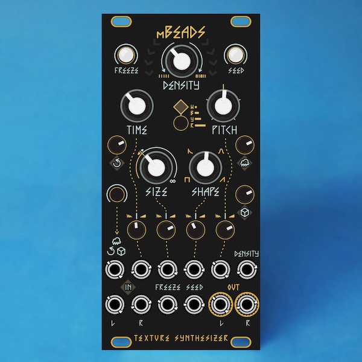

mBeads is a 12hp remix of [Mutable Instruments' Beads](https://pichenettes.github.io/mutable-instruments-documentation/modules/beads/) by Emilie Gillet.

## Changes:

- Eagle files imported into KiCad.
- Single PCB split into two narrower PCBs, using pin headers as board-to-board connectors with m3 standoff for strength.
- Both PCBs only require single sided PCBA for SMD parts.
- BOM changes:
  - THT LEDs swapped for SMD using panel translucency (or light pipes).
  - LP4OA1PBCT* illuminated switch swapped for PB6149L* style.
  - Broadcom ASMB-KTF0-0A306 switched to OSRAM LRTBGVSR* RGB LED.
  - New LEDs require resistor changes.
  - SMD tact switches now standard THT parts.
  - Most footprints changed from Eagle to KiCad standard library.
  - Many passives (resistors, caps, inductors, diodes, etc) have had footprints changed due to availability.

License
-------

[cc-by-sa-3.0](https://creativecommons.org/licenses/by-sa/3.0/)

